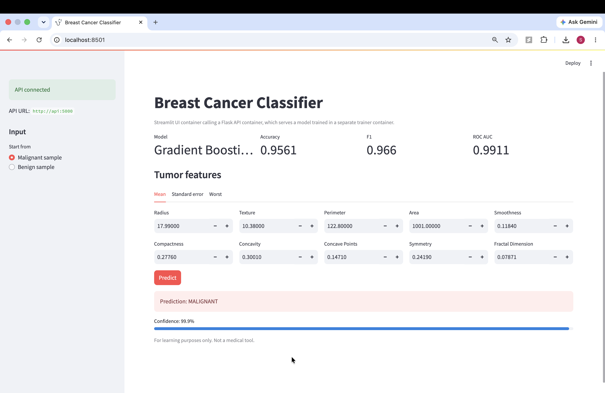
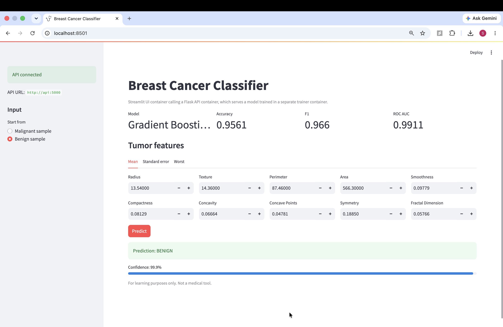
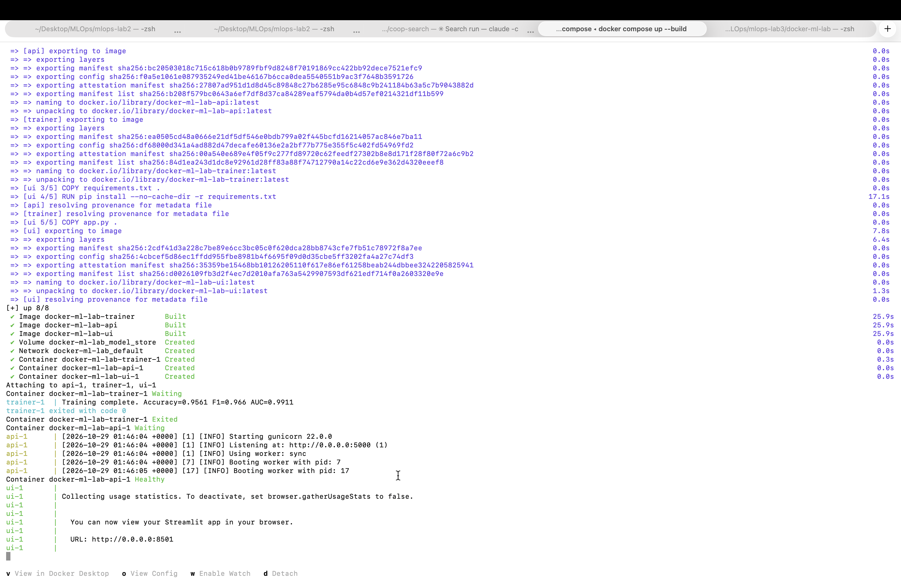
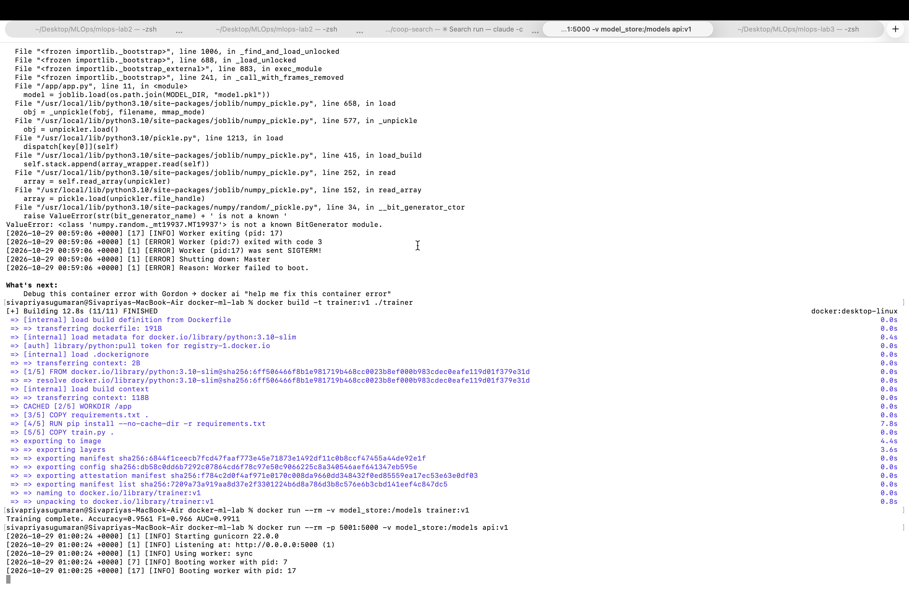
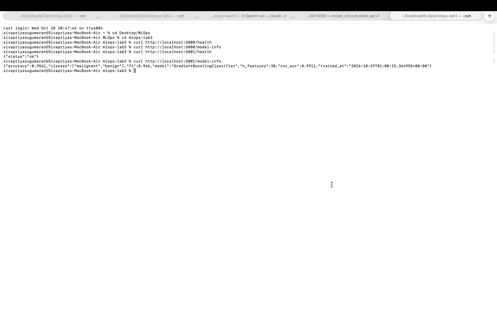
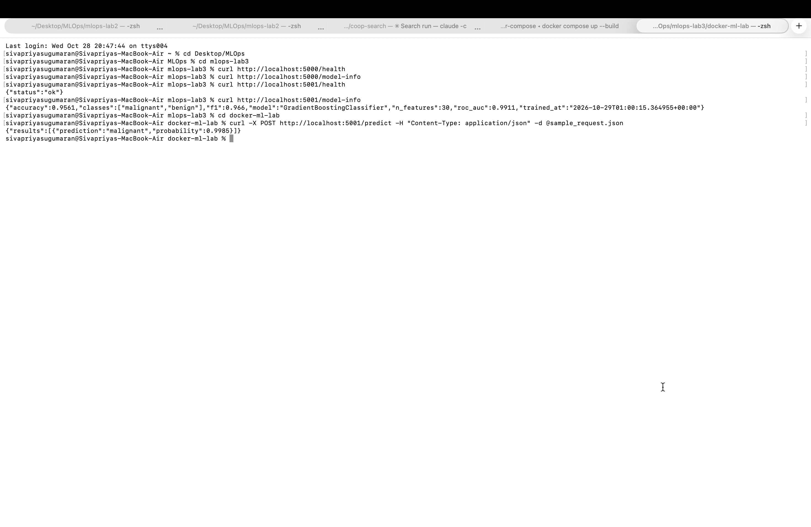
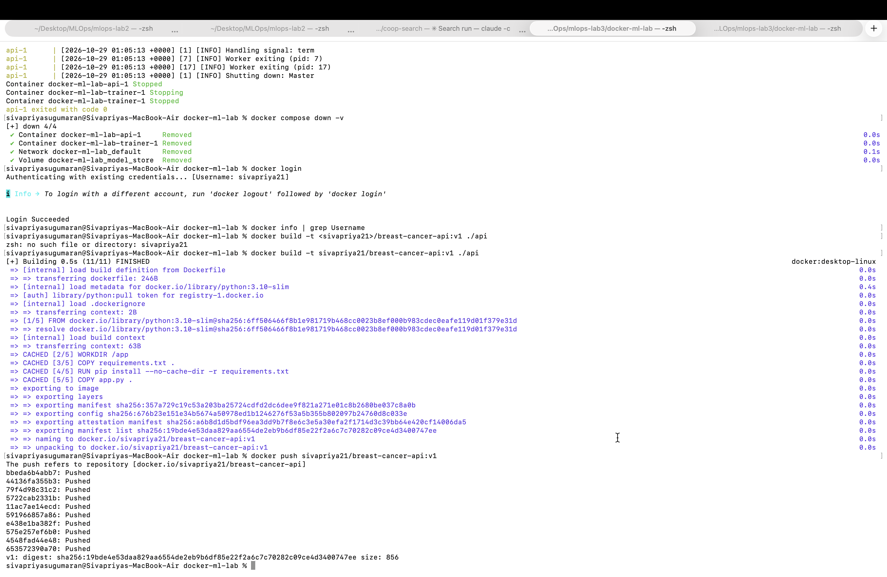

# Docker Lab: Train, Serve and Use an ML Model with Docker Compose

This lab is based on Docker_Labs Lab1 and Lab2 from the course MLOps repo. Lab1 trains a model inside a single container. Lab2 uses Docker Compose with a trainer service, a serving service and a shared volume. I kept the Compose design and rebuilt it as three services: a trainer, a Flask API and a Streamlit UI, with a new dataset, model, dependency pinning, a healthcheck and a Docker Hub push.

## What I changed from the original labs

| Original Lab1 and Lab2 | This lab |
|---|---|
| Iris dataset (4 features) | Breast Cancer Wisconsin dataset (30 features) |
| Random Forest (Lab1), Keras neural net (Lab2) | Gradient Boosting inside a StandardScaler pipeline |
| Two services: trainer and serving | Three services: trainer, API and UI |
| HTML page served by the model container | Separate Streamlit UI container that calls the API over the Docker network |
| pip install runs every time a container starts (Lab2) | Dependencies baked into each service's Dockerfile |
| Unpinned package versions | Pinned versions in every container |
| Flask development server | Gunicorn production server |
| No healthcheck | API healthcheck; the UI starts only when the API is healthy |
| No evaluation | Accuracy, F1 and ROC AUC saved to `metrics.json` and shown in the UI |
| Images built locally only | API image pushed to Docker Hub |

Pinning matters here: the trainer first installed NumPy 2 while the API used NumPy 1.26, so the API could not load the saved model. Pinning identical NumPy and scikit-learn versions in both containers fixed it.

## Architecture

```
trainer  ──writes──>  model_store volume  ──reads──>  api (Flask + Gunicorn)  <──HTTP──  ui (Streamlit)
```

1. The `trainer` container trains the model, writes `model.pkl` and `metrics.json` to the `model_store` volume, then exits.
2. The `api` container starts only after the trainer finishes successfully. It loads the model and serves the REST API. A healthcheck calls `/health` every 5 seconds.
3. The `ui` container starts only after the API is healthy. It reaches the API by its service name at `http://api:5000` over the Compose network.

## Project structure

```
docker-ml-lab/
├── trainer/
│   ├── Dockerfile
│   ├── requirements.txt
│   └── train.py
├── api/
│   ├── Dockerfile
│   ├── requirements.txt
│   └── app.py
├── ui/
│   ├── Dockerfile
│   ├── requirements.txt
│   └── app.py
├── docker-compose.yml
├── sample_request.json
├── screenshots/
└── README.md
```

## Run it

```sh
docker compose up --build
```

Open the Streamlit UI at http://localhost:8501, or test the API from a second terminal:

```sh
curl http://localhost:5001/health
curl http://localhost:5001/model-info
curl -X POST http://localhost:5001/predict \
  -H "Content-Type: application/json" \
  -d @sample_request.json
```

Expected output:

```json
{"results":[{"prediction":"malignant","probability":0.9985}]}
```

Stop and clean up:

```sh
docker compose down -v
```

Port 5001 is used on the host because macOS AirPlay Receiver uses port 5000.

## Services and ports

| Service | Host port | Purpose |
|---|---|---|
| trainer | none | Trains the model and exits |
| api | 5001 | REST API |
| ui | 8501 | Streamlit web UI |

## API endpoints

| Method | Endpoint | Description |
|---|---|---|
| GET | `/health` | Health check used by Docker |
| GET | `/model-info` | Model name, metrics and training time |
| POST | `/predict` | Takes `{"features": [30 numbers]}` and returns class and probability |

## Results

| Metric | Score |
|---|---|
| Accuracy | 0.9561 |
| F1 | 0.9660 |
| ROC AUC | 0.9911 |

## Docker Hub

The API image is available at [sivapriya21/breast-cancer-api](https://hub.docker.com/r/sivapriya21/breast-cancer-api).

```sh
docker pull sivapriya21/breast-cancer-api:v1
```

## Screenshots

**Streamlit UI: malignant prediction**


**Streamlit UI: benign prediction**


**Docker Compose running all three services**


**Trainer container**


**API health and model info**


**Prediction through the API**


**Docker Hub push**


## Docker concepts covered

Images, containers, Dockerfiles, port mapping, named volumes, multi-container apps with Docker Compose, service-to-service networking, healthchecks, service dependencies, dependency pinning and pushing to a registry.